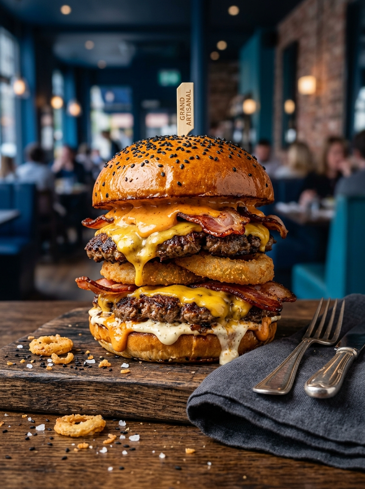
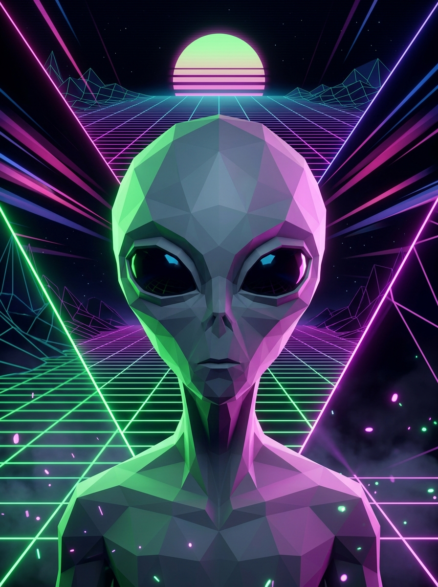
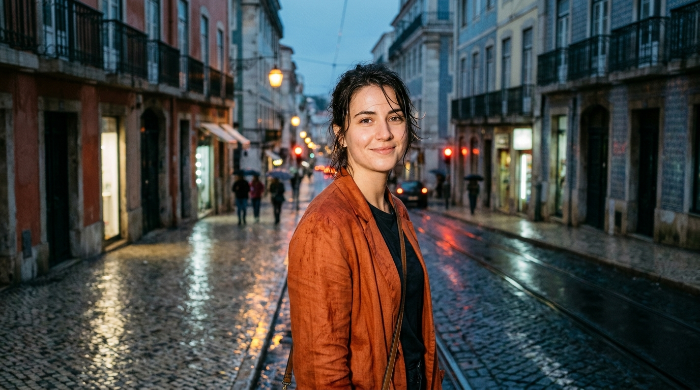
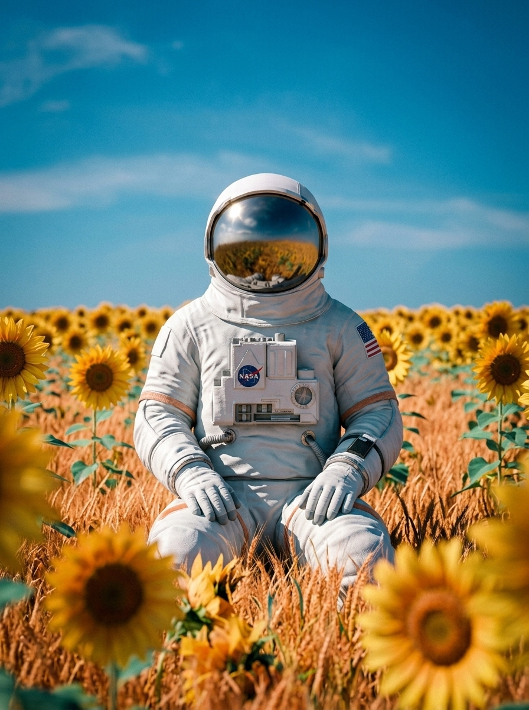
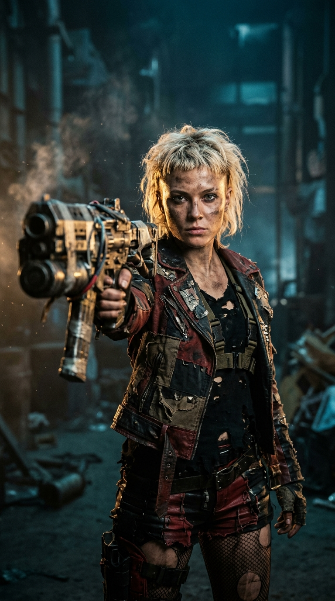
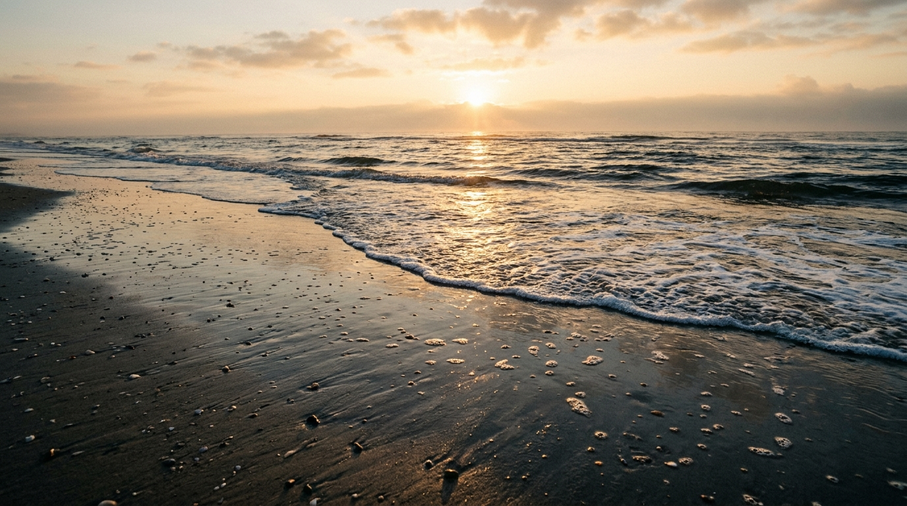
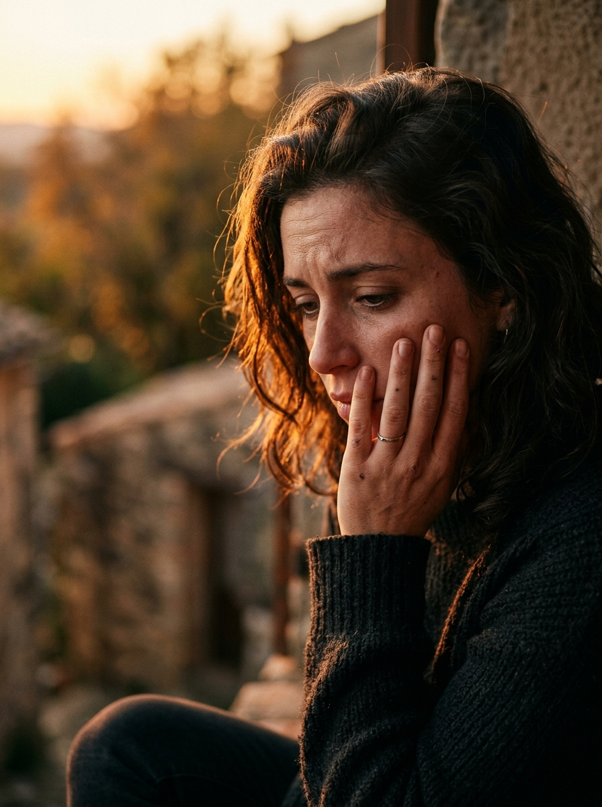
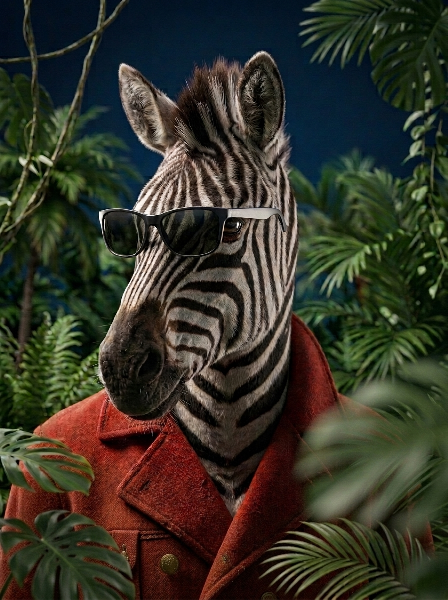

# Prompt Mestre para Geração de Imagens

Um prompt interativo para transformar uma ideia em uma descrição visual detalhada, pronta para ser usada em um gerador de imagens por IA.

## Como funciona

O assistente conduz a criação do prompt fazendo uma pergunta por vez. Você responde com suas preferências ou pula qualquer item que não se aplique. Ao final, ele reúne as escolhas em um parágrafo detalhado, escrito em inglês, com foco em uma imagem de alta qualidade.

## Exemplos de imagens

Algumas imagens de exemplo geradas com prompts criados a partir deste fluxo:

<table>
	<tr>
		<td align="center" width="25%"> Hambúrguer artesanal</td>
		<td align="center" width="25%"> Alien synthwave</td>
		<td align="center" width="25%"> Retrato cinematográfico</td>
		<td align="center" width="25%"> Astronauta entre girassóis</td>
	</tr>
	<tr>
		<td align="center" width="25%"> Personagem punk</td>
		<td align="center" width="25%"> Amanhecer na praia</td>
		<td align="center" width="25%"> Retrato emocional</td>
		<td align="center" width="25%"> Zebra estilizada</td>
	</tr>
</table>

## O que ele ajuda a definir

- **Tema principal:** o assunto ou a cena que deve aparecer na imagem.
- **Estilo visual:** por exemplo, aquarela, anime, fotorrealismo, arte vetorial, pop art ou xilogravura.
- **Atmosfera:** a sensação transmitida, como aconchegante, misteriosa, épica ou melancólica.
- **Iluminação:** tipo, direção e caráter da luz, como luz natural suave, neon ou luz dramática lateral.
- **Paleta de cores:** combinação e temperatura das cores, como tons pastel, monocromáticos ou cores vibrantes.
- **Composição:** organização dos elementos, enquadramento, perspectiva e profundidade de campo.
- **Tipo de câmera ou lente:** referências de equipamento e perspectiva fotográfica, quando forem relevantes.
- **Detalhes adicionais:** qualquer elemento específico que você queira acrescentar.

As opções sugeridas em cada etapa servem como inspiração; você também pode responder com uma escolha própria.

## Como usar

1. Abra [`prompt_mestre.md`](prompt/prompt_mestre.md) e copie o conteúdo.
2. Cole o texto nas instruções de um assistente de IA capaz de seguir prompts, ou envie-o como a primeira mensagem de uma conversa.
3. Responda às perguntas uma por vez. Para deixar um campo em branco, diga que ele não se aplica ou que deseja pular.
4. Quando o assistente perguntar sobre detalhes adicionais, inclua o que ainda não foi coberto ou indique que não há mais nada.
5. Copie o parágrafo final em inglês e use-o na ferramenta de geração de imagens de sua preferência.

## Dicas

- Descreva o tema principal com elementos concretos, como sujeitos, cenário e ação em detalhes.
- Para ter mais controle, especifique detalhes importantes nas respostas em vez de depender apenas das opções sugeridas.
- Nem toda referência de câmera ou lente é útil para todos os estilos. Pule esse campo quando não fizer sentido para a imagem.
- O resultado é um prompt textual; a geração da imagem acontece em uma ferramenta de imagens separada.

## Arquivo

- [`prompt_mestre.md`](prompt/prompt_mestre.md): prompt completo usado para iniciar o fluxo interativo.